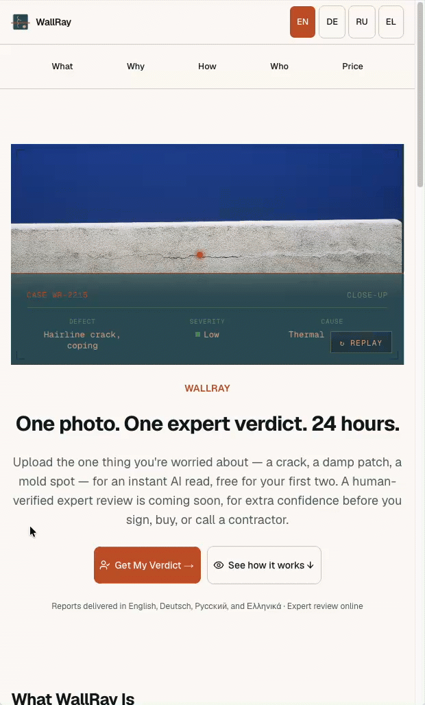

# WallRay

AI-powered building defect assessment. Upload photos, receive a classified defect report with repair cost estimates.



## What this project demonstrates

This is a solo-built, end-to-end portfolio project — not just a model wrapper. It's used here to showcase my current engineering skill set:

- 🧭 **Spec-driven development with AI** — every feature started as a written plan (`docs/tech/*_PLAN.md`) before a line of code, used to direct AI-assisted implementation rather than vibe-coding against it
- ⬡ **Hexagonal architecture (backend)** — ports & adapters in `be/`, domain core isolated from FastAPI, Postgres, S3, and the LLM provider (see `docs/tech/ARCHITECTURE.md`)
- 🧱 **Layered domain architecture (frontend)** — a strict one-directional `ui/business → ui/base`, `services/business → services/tech` dependency flow in `fe/`, enforced by convention, not just discipline
- 🔗 **Vertical type safety, BE → FE** — FastAPI's Pydantic models are the single source of truth; `mise run schema:sync` exports them to `be/openapi.json` and feeds that through [openapi-typescript](https://openapi-ts.dev/) to generate `fe/types/api.ts`, so a backend schema change that isn't reflected on the frontend fails `tsc`, not at runtime (see [Type Safety](#type-safety) below)
- 🌐 **i18n for 3 languages (EN/DE/RU)** — customer-facing copy, legal pages, and marketing pages all localized and routed natively in Next.js (App Router), not bolted on with a translation layer
- 🎭 **End-to-end testing against a fully deployed app** — Playwright suite exercising the real test environment over the network, not a mocked build
- 🔬 **"Unit size discovery" testing strategy** — a deliberate split between infrastructure code (stable APIs, high reuse → worth isolated unit tests) and feature code (one-off, evolves fast → prefer sociable tests with real collaborators over brittle mocks); see [docs/tech/unit-size-discovery-theory.md](docs/tech/unit-size-discovery-theory.md)
- 🔁 **Full-scale CI** — lint, typecheck, and tests on every push; automatic promotion to a live test environment; a separate gated workflow for production
- 🖥️ **Self-hosted deployment on Hetzner** — Coolify-orchestrated Docker services behind Traefik, with its own DB, object storage, and SSL — no PaaS magic

## Documentation

Every feature in this repo started as a written plan before any code — the full set lives in [docs/tech/](docs/tech/):

| Doc                                                                                           | What it covers                                                          |
| ----------------------------------------------------------------------------------------------- | -------------------------------------------------------------------------- |
| [TECH_PLAN.md](docs/tech/TECH_PLAN.md)                                                         | Architecture, component breakdown, build sequence, technology decisions |
| [ARCHITECTURE.md](docs/tech/ARCHITECTURE.md)                                                   | Backend hexagonal architecture (ports & adapters)                      |
| [BE_PHASE1_PLAN.md](docs/tech/BE_PHASE1_PLAN.md)                                                | Backend phase 1 implementation plan                                    |
| [BE_PHASE2_PLAN.md](docs/tech/BE_PHASE2_PLAN.md)                                                | Backend phase 2 implementation plan (revised)                          |
| [BE_PHASE3_PLAN.md](docs/tech/BE_PHASE3_PLAN.md)                                                | Backend phase 3 plan                                                    |
| [FE_PHASE1_PLAN.md](docs/tech/FE_PHASE1_PLAN.md)                                                | Frontend phase 1 implementation plan                                   |
| [AUTH_PLAN.md](docs/tech/AUTH_PLAN.md)                                                          | Auth integration plan (OTP sign-in, JWT, NextAuth)                     |
| [BE_IMAGES_HANDLING.md](docs/tech/BE_IMAGES_HANDLING.md)                                        | Backend photo upload/handling plan                                     |
| [AI_ASSESSMENT_REWORK.md](docs/tech/AI_ASSESSMENT_REWORK.md)                                    | AI assessment pipeline rework — implementation plan                    |
| [AI_ASSESSMENT_REWORK_TODO.md](docs/tech/AI_ASSESSMENT_REWORK_TODO.md)                          | Delta TODO tracking the AI assessment rework                           |
| [AI_ASSESSMENT_UNIFIED_REPORT.md](docs/tech/AI_ASSESSMENT_UNIFIED_REPORT.md)                    | Unified single-report model for the AI assessment                      |
| [AI_ASSESSMENT_INTAKE_PLAN.md](docs/tech/AI_ASSESSMENT_INTAKE_PLAN.md)                          | Structured intake questions extending the assessment's context signals |
| [LANGUAGE_PLAN.md](docs/tech/LANGUAGE_PLAN.md)                                                  | Multi-language handling implementation plan                            |
| [FREE_TIER_ANTI_ABUSE_PLAN.md](docs/tech/FREE_TIER_ANTI_ABUSE_PLAN.md)                          | Free-tier anti-abuse implementation plan                               |
| [NEW_USER_NOTIFICATION_PLAN.md](docs/tech/NEW_USER_NOTIFICATION_PLAN.md)                        | New-user registration notification plan                                |
| [PALETTE_MIGRATION_PLAN.md](docs/tech/PALETTE_MIGRATION_PLAN.md)                                | Design-system color palette migration plan                             |
| [E2E_TESTING_PLAN.md](docs/tech/E2E_TESTING_PLAN.md)                                            | Playwright E2E UI test suite, run against a fully deployed environment |
| [TESTING_PLAN.md](docs/tech/TESTING_PLAN.md)                                                    | Testing plan — closing the repository/default test-coverage gap       |
| [unit-size-discovery-theory.md](docs/tech/unit-size-discovery-theory.md)                        | Unit size discovery: infrastructure vs. feature code                   |

## Requirements

- [mise](https://mise.jdx.dev) — manages Python 3.13, Node 22, uv, pnpm (`brew install mise`)
- [Docker](https://docs.docker.com/get-docker/) — for Postgres, Qdrant, Ollama, Redis

## Quick Start

```bash
mise trust
mise install           # installs Python 3.13, Node 22, uv, pnpm
mise run install       # installs be/ and fe/ dependencies
cp .env.local.example .env.local
mise run dev           # starts API (port 8000) + Next.js (port 3000)
```

## Tasks

```bash
# Backend
mise run be-api        # FastAPI dev server with hot reload
mise run be-test       # pytest
mise run be-check      # ruff format + lint + pyright

# Frontend
mise run fe-dev        # Next.js dev server
mise run fe-check      # tsc + biome check

# Both
mise run check         # all static analysis
mise run kill          # kill all dev processes
```

## Type Safety

The FE/BE boundary is statically typed end-to-end, with the backend's Pydantic models as the
single source of truth — no hand-maintained request/response interfaces to drift out of sync:

```
be/app/api/schemas.py  (Pydantic models)
        │  app.openapi()
        ▼
be/openapi.json                              ← mise run schema:export
        │  openapi-typescript
        ▼
fe/types/api.ts  (paths / components["schemas"] types)   ← mise run schema:gen
        │  imported by fe/services/business/*.ts
        ▼
typed HttpS.get/post/patch calls, typed React Query hooks
```

- `mise run schema:export` — imports the FastAPI app and dumps `app.openapi()` straight to
  `be/openapi.json`; no running server needed.
- `mise run schema:gen` — runs `openapi-typescript` against that file to (re)generate
  `fe/types/api.ts` (auto-generated, not hand-edited — see the header comment in that file).
- `mise run schema:sync` — the two above, run after any Pydantic schema change.
- `mise run schema:check` — CI guard: re-runs `schema:sync` and fails the build if
  `be/openapi.json` or `fe/types/api.ts` doesn't match what's committed, so a backend model
  change without a regenerated frontend type can't merge silently.

Frontend services import the generated types directly (`components["schemas"]` from
`@/types/api`, e.g. `fe/services/business/JobS.ts`) rather than redeclaring response shapes by
hand, so a renamed or removed backend field becomes a `tsc` compile error in the frontend instead
of an `undefined` discovered in production.

## Project Structure

```
wallray/
├── be/                 # FastAPI + LangGraph pipeline
│   ├── app/
│   │   ├── api/        # Route handlers
│   │   ├── pipeline/   # LangGraph nodes
│   │   └── core/       # Config, settings
│   └── pyproject.toml
├── fe/                 # Next.js frontend (App Router, Tailwind, Biome)
├── docs/               # Architecture and engineering documentation
├── mise.toml           # Tool versions + task runner
└── .gitignore
```

## Stack

| Layer      | Technology                                      |
| ---------- | ------------------------------------------------ |
| API        | FastAPI + LangGraph                              |
| LLM        | Anthropic Claude (vision + text)                 |
| Database   | PostgreSQL + SQLAlchemy (async) + Alembic        |
| Storage    | S3-compatible object storage (Hetzner)           |
| Frontend   | Next.js 16 (App Router) + React 19 + Tailwind CSS |
| Auth       | NextAuth + JWT                                   |
| Testing    | pytest (backend) + Playwright (E2E)              |
| CI/CD      | GitHub Actions                                   |
| Deployment | Hetzner VPS + Coolify (Docker + Traefik)          |
